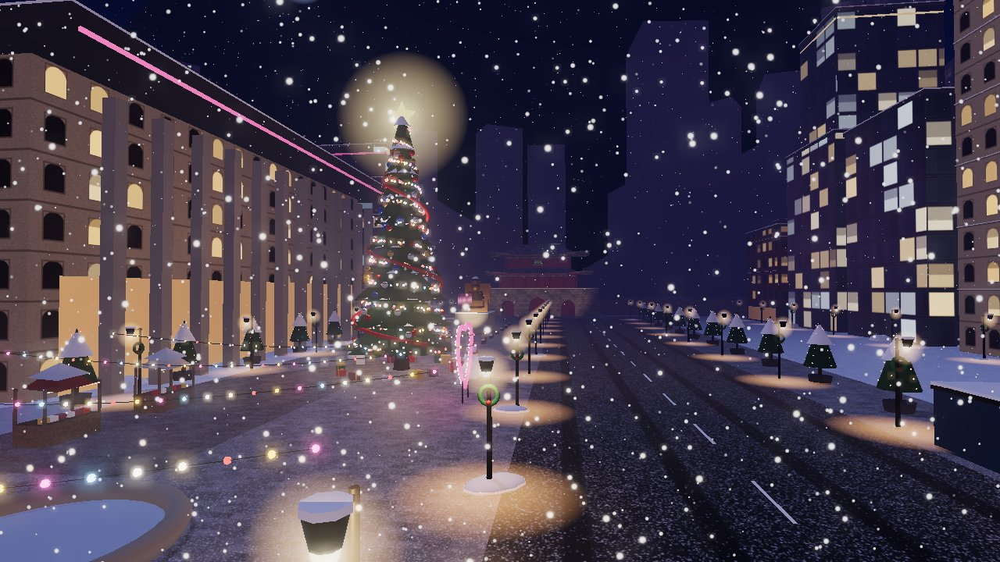

# ❄️ Christmas World Seoul

A 3D Christmas social metaverse set in six districts of Seoul — meet people, chat, whisper, make friends, hold hands and talk with proximity voice while it snows.



## Quick start
```bash
npm install
npm run build
npm start          # → http://localhost:3000
```
Development (hot reload): `npm run dev` → http://localhost:5173

Microphones require HTTPS outside `localhost`. For voice across networks set `TURN_URL`, `TURN_USER`, `TURN_PASS`.

## Tests
```bash
npm test                                       # unit + server integration
npm run build && PORT=3100 npm start &
BASE=http://localhost:3100 npm run test:e2e    # multi-browser E2E (Playwright/Chromium)
node scripts/loadtest.js 50 20                 # bot load test
BASE=http://localhost:3100 npm run thumbs      # regenerate world-map card thumbnails
```

## Docs
`docs/CURRENT_PROJECT_AUDIT.md` · `ARCHITECTURE.md` · `UI_UX_SPEC.md` · `WORLD_MAP_SPEC.md` · `MULTIPLAYER_SPEC.md` · `VOICE_CHAT_SPEC.md` · `QA_REPORT.md` · `DEVELOPMENT_REPORT.md`

## Controls
WASD move · Shift run · Space jump · drag to look · wheel zoom · Enter chat · F snowball · V mic · 1/2/3 emotes · P photo · X release hand · M map · F3 stats. On phones: left side joystick, right side look.

Carols are public-domain compositions synthesised in the browser; all textures are procedural. Seoul layouts are stylised approximations.
